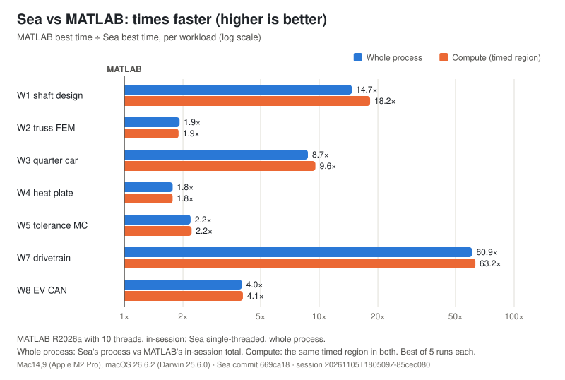
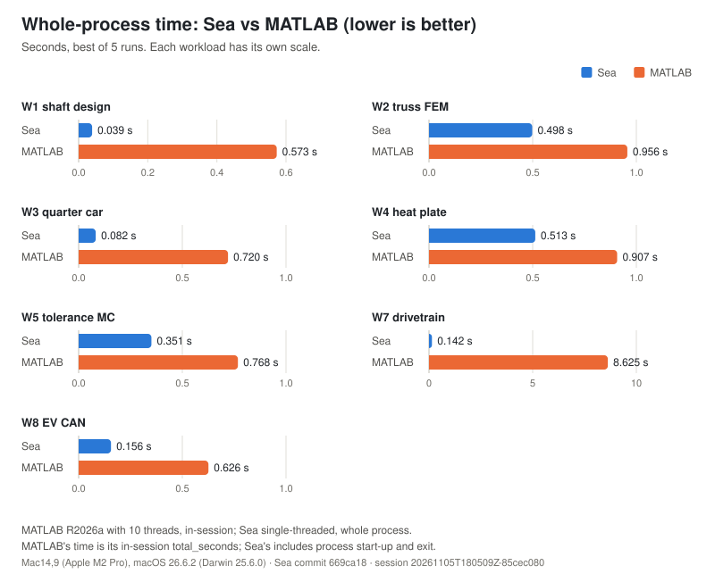

# Sea

Sea is a matrix and numerical programming language meant as an alternative to MATLAB. It has a
C/Rust-like syntax and is not MATLAB-compatible. It is the child project of
[Baysick](https://github.com/frgmt0/Baysick), a rebuild of Dartmouth BASIC (1964) written in
assembly, and the Sea compiler is itself written in Baysick.

Sea is version 1.0.0: v1 is done, and it is no longer alpha. The language is specified in
docs/LANGUAGE.md. The compiler, runtime, tests and plan are in docs/DESIGN.md.

## At a glance: why Sea

The charts compare Sea with MATLAB on seven engineering workloads, best of 5 runs on the same Mac.
The first shows how many times faster Sea is on each workload; the second shows the seconds each
one takes.

<picture><source media="(prefers-color-scheme: dark)" srcset="docs/img/speedup-dark.svg"></picture>

<picture><source media="(prefers-color-scheme: dark)" srcset="docs/img/times-dark.svg"></picture>

| Workload | Sea wall (s) | MATLAB wall (s) | Sea compute (s) | MATLAB compute (s) |
|:---|---:|---:|---:|---:|
| w1_shaft_design | 0.039 | 0.573 | 0.028 | 0.511 |
| w2_truss_fem | 0.498 | 0.956 | 0.493 | 0.936 |
| w3_quarter_car | 0.082 | 0.720 | 0.066 | 0.631 |
| w4_heat_plate | 0.513 | 0.907 | 0.510 | 0.902 |
| w5_tolerance_mc | 0.351 | 0.768 | 0.345 | 0.764 |
| w7_drivetrain | 0.142 | 8.625 | 0.136 | 8.602 |
| w8_ev_can | 0.156 | 0.626 | 0.152 | 0.617 |

Best of 5, seconds. Wall is the whole process for Sea and MATLAB's in-session `total_seconds`; compute is the timed region. Measured on Mac14,9 (Apple M2 Pro), macOS 26.6.2 (Darwin 25.6.0), Sea commit `669ca18`, session `20261105T180509Z-85cec080`; see [docs/BENCH.md](docs/BENCH.md).

## Goals

In priority order:

1. Speed. Programs are compiled ahead of time to native code. Element-wise expressions are fused so
   they run without temporary arrays. The numeric kernels are hand-written SIMD (NEON on arm64,
   SSE2 and AVX2 on x86_64), chosen at run time by CPU feature. Apple Accelerate and OpenBLAS are
   the benchmark baselines, not dependencies.
2. A cleaner language than MATLAB.
3. Free, small and portable: standalone native binaries and no large runtime.

No performance claim goes in without a measurement behind it.

## Status

Phase 10 is done and v1 is complete (version 1.0.0): all seven workloads run faster than MATLAB on
both measures, as the table above shows and docs/BENCH.md documents. DESIGN.md §8 has the full
milestone table.

- The compiler is a chain of passes: `seaparse`, `seaname`, `seacheck`, `seaexpand`, `seafuse`,
  `sealoop`, `sealower`, `seaopt`, `sealopt`, `seavec`, then a code generator per target
  (`seagen_a64` or `seagen_x64`).
- Two targets work: arm64 macOS natively, and x86_64 Linux, cross-compiled on the Mac and tested
  on a Linux host. The runtime is in assembly for each target.
- The language covers scalars, dynamic and fixed-size arrays, structs, strings, functions with
  named and default arguments, formatted output, `write_json`, fusion and SIMD code
  generation, and the matrix product `@`.
- Linear algebra: `lu`, `chol`, `solve`, `rcond` and `eig_sym`, with the `Lu` and `Chol` handle
  types. Plotting writes SVG figures.
- Phase 10 measured the seven workloads against MATLAB, and the matrix kernels, micro-benchmarks
  and Linux x86_64 beside them; docs/BENCH.md has the methodology and every result.

## Workloads

`workloads/` has eight MATLAB scripts that look like ordinary engineering work: shaft sizing,
truss FEM, a quarter-car model, plate heat conduction, a Monte Carlo tolerance stack-up, topology
optimisation, a buggy drivetrain and an EV controller whose CAN log is read, decoded and plotted.
W1 to W5, W7 and W8 are the seven acceptance targets for v1. A Sea port of each has to reproduce
the MATLAB numbers and report, and run faster. W6 is an extra reference for later.

`ports/` has the Sea ports of W1, W2, W3, W4, W5, W7 and W8. `tests/accept.sh` runs them and compares
every output key and the text report with the MATLAB reference. `workloads/README.md` describes
the scripts and how the reference values are produced and compared.

Recorded numbers: on an Apple M2 Pro the W7 port computes in 0.134 to 0.135 s, against 8.602 s
for MATLAB's best compute time. DESIGN.md §6.3 notes this is a record and not a measurement under
the benchmark methodology. W7 compiles in 17.4 to 20.8 s. The W2 port computes in 0.495 to 0.504 s
and W3 in 0.067 to 0.068 s, against MATLAB's best of 0.936 s and 0.631 s with default threads and
0.358 s and 0.646 s on one thread; DESIGN.md §6.3 ("Measured at 8d") records these the same way,
not as benchmark measurements.

## Relationship to Baysick

Sea lives in its own repository and is a git submodule of the Baysick repository at `sea/`. When
Sea needs something Baysick lacks, the feature is added to Baysick, following the later Dartmouth
editions where it can. Baysick (version 0.6.0) now covers the Second through Sixth Editions plus
a few extensions of its own, and has the two targets `arm64-macos` and `x86_64-linux`.

## Getting it

Clone Baysick with its submodules:

```bash
git clone --recurse-submodules https://github.com/frgmt0/Baysick
```

Or clone Sea directly:

```bash
git clone https://github.com/frgmt0/Sea
```

## Building and testing

The passes are compiled with Baysick, so build Baysick first (`make` in the Baysick directory, or
set `BAYSICK=<dir>`; the default is `..`). Then, in the Sea directory:

```bash
make                         # runtime, tools, passes, install into build/
build/sea build prog.sea -o prog
build/sea run prog.sea
make test                    # every test group, even if one fails
make cross                   # x86_64 Linux tests over ssh
```

`make test` needs the Apple toolchain (`as`, `ld`, `xcrun cc`) and `uv`, which the acceptance
comparison uses. `make cross` packs a bundle on the Mac and runs it on a Linux host over ssh. The
host defaults to `$SEA_CROSS_HOST`, else `desktop`, and needs GNU `as`, `gcc` and `make`.
CLAUDE.md lists the rest of the commands.
